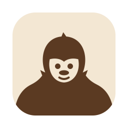
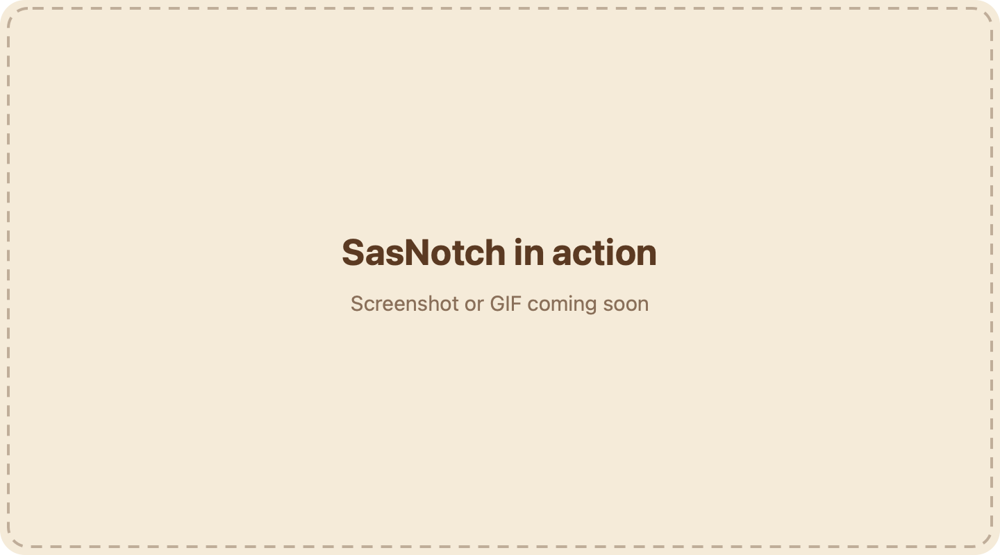
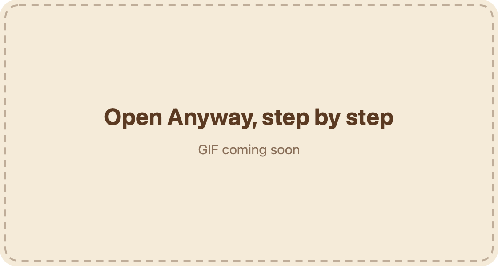

<p align="center">
  
</p>

<h1 align="center">SasNotch</h1>

<p align="center">A Dynamic Island for your Mac's notch, with a dozen everyday utilities inside it.</p>

**Install with one line** (paste into Terminal):

```sh
curl -L https://github.com/Rsunthar2027/SasNotch/releases/latest/download/SasNotch.zip -o /tmp/SasNotch.zip && unzip -o /tmp/SasNotch.zip -d /Applications && open /Applications/SasNotch.app
```

Files that `curl` downloads are not quarantined, so macOS opens SasNotch without a Gatekeeper warning.

<p align="center">
  <!-- Replace with a screenshot or GIF of the island opening on hover (docs/hero.gif). -->
  
</p>

## What it does

Point at the notch and the island opens. Click it and it stays open until you click away or press Esc. Everything inside works on the first click.

**Around the notch**
- Music controls with album art, a live visualizer, lyrics and the up-next queue
- Timers, a stopwatch and a Pomodoro, with a countdown in the notch
- Your next calendar events and a month view
- Notifications, download progress and AI agent usage (Claude, Codex and others)
- A file shelf: drop files on the island and pick them up later
- Mirror: a live camera preview for checking yourself before a call. The camera turns off when the island closes.
- Notices for volume, brightness, charging, Bluetooth devices, Focus on or off, and apps using the camera or microphone
- Lock screen widgets: music, timers, calendar, battery while charging, and the weather

**Utilities**
- Per-app volume mixer that can boost quiet apps past 100%, and microphone tools
- System monitor: CPU, GPU, memory, temperatures, network and disk
- App switcher with live window thumbnails, window snapping layouts and Dock previews
- Clipboard history, text snippets, and Finder cut and paste (⌘X, ⌘V)
- Keep awake, a color picker, an app uninstaller and more

Every part is a module you can switch on or off in Settings. You can resize the island and change its corners, choose Minimalistic or Standard mode, and remap its shortcuts. On macOS 26 the island uses Liquid Glass. Macs without a notch get a floating island at the top of the screen.

## Install

### One line (recommended)

Use the command at the top of this page. It downloads the latest release, puts SasNotch in Applications and opens it. To update by hand, run it again. SasNotch also updates itself: Menu bar icon › Check for Updates.

### From the browser

1. Download **SasNotch.dmg** from the [latest release](https://github.com/Rsunthar2027/SasNotch/releases/latest).
2. Open it and drag SasNotch to Applications.
3. Open SasNotch. macOS says it can't verify the developer, because SasNotch is signed with its own certificate rather than a paid Apple Developer ID.
4. Open **System Settings › Privacy & Security**, scroll down to the message about SasNotch and click **Open Anyway**, then confirm.

<!-- Replace with a GIF of these steps (docs/open-anyway.gif). -->


If you prefer Terminal, this removes the download quarantine so the app opens directly:

```sh
xattr -dr com.apple.quarantine /Applications/SasNotch.app
```

## Requirements

- A Mac with Apple Silicon (M1 or later)
- macOS 14 Sonoma or later
- Liquid Glass needs macOS 26 Tahoe. Earlier versions get a blurred background instead.

## Permissions

The first launch shows one screen with an **Allow** button for each permission. All of them are optional: skip one and only the features that need it stop working. You can change any of them later in System Settings › Privacy & Security.

| Permission | What uses it |
|---|---|
| Accessibility | Volume and brightness keys in the island, window snapping, the app switcher, Finder cut and paste |
| Screen Recording | Live thumbnails in the app switcher and Dock previews, screenshots |
| Camera | The Mirror tab, and only while it is open |
| Calendar | Your events in the island and on the lock screen |
| Music (Automation) | Shuffle and track details in the Music app. Play, pause and skip work without it. |
| Notifications | Timer alerts and notices from SasNotch |

Two more are asked for only when you use the feature: System Audio Recording for the per-app volume mixer and the music visualizer, and Location for lock screen weather if you don't type in a city.

SasNotch has no account, no analytics and no tracking. It goes online only for things you can see: its own update checks, lyrics and album art lookups, weather, the network speed test, Homebrew actions and checks for updates to your other apps.

Every release is signed with the same certificate, so the permissions you grant carry over to updates.

## FAQ

**The island doesn't open.** Check that SasNotch is running (its sasquatch is in the menu bar) and that the island isn't paused: Menu bar icon › Resume Island. In Settings › Dynamic Island › Behavior you can choose how it opens and set the hover delay.

**How do I keep it open?** Click the island. A small pin appears at the bottom. Click the pin, click anywhere outside, or press Esc to close it.

**The Focus button asks me to make a shortcut.** macOS only lets apps turn Focus on or off through the Shortcuts app. Make a shortcut named "SasNotch Focus" with the "Set Focus" action, set to toggle Do Not Disturb, and the button runs it. Showing when Focus changes works without the shortcut.

**Thumbnails are blank after I allowed Screen Recording.** macOS applies that permission only after the app reopens. Quit SasNotch from its menu and open it again.

**Can I run it alongside other notch apps?** They draw over the same spot. Quit the others while you use SasNotch.

## Uninstall

1. Click the menu bar icon and choose **Quit**.
2. Drag **SasNotch** from Applications to the Trash.
3. To also remove its settings, caches, login item and granted permissions, run:

```sh
curl -fsSL https://raw.githubusercontent.com/Rsunthar2027/SasNotch/main/Tools/uninstall.sh -o /tmp/sasnotch-uninstall.sh && zsh /tmp/sasnotch-uninstall.sh
```

## Build from source

You need the Xcode Command Line Tools (`xcode-select --install`). Full Xcode is optional.

```sh
git clone https://github.com/Rsunthar2027/SasNotch.git
cd SasNotch
./build.sh --dev --install
```

This builds a separate "SasNotch (Developer)" app and installs it. Run the tests with `./build.sh --test`. To work in Xcode, open `Package.swift`. [CONTRIBUTING.md](CONTRIBUTING.md) has the details.

## Credits

SasNotch is a derivative work. It is built on, and inspired by, these open-source projects, all under the GNU General Public License v3:

- **[Vorssaint](https://github.com/vorssaint/vorssaint-utils)** by Vorssaint: SasNotch started from its source code, which provides the utilities and the Dynamic Island. Copyright (C) 2026 Vorssaint.
- **[Atoll](https://github.com/Ebullioscopic/Atoll)** by the Atoll contributors: the Focus, camera and microphone, lock screen weather and charging features were ported from it. Copyright (C) 2024–2026 Atoll Contributors.
- **[Boring.Notch](https://github.com/TheBoredTeam/boring.notch)** by TheBoredTeam: the notch app Atoll is built on.

Their copyright notices are kept in the source files that came from them, and [NOTICE](NOTICE) lists the exact versions SasNotch started from. SasNotch is an independent project: it is not affiliated with or endorsed by Vorssaint, Atoll, TheBoredTeam or Apple, and it uses none of their names or artwork. Weather data comes from [Open-Meteo](https://open-meteo.com) (CC BY 4.0).

## License

[GNU General Public License v3.0](LICENSE) or later. Copyright (C) 2026 SasNotch contributors, with the upstream copyrights above.
